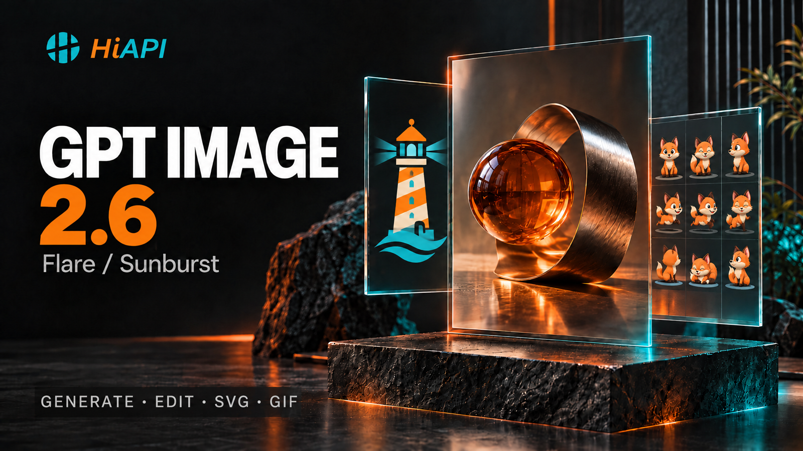

# GPT Image 2.6 Agent Skill — text, vector, and animation in one command

Generate a product shot, export a logo as real SVG, render a short GIF, or repaint
one area of a local photo through HiAPI from Codex or Claude Code. The CLI picks
the model from your inputs — `gpt-image-2.6-flare/text-to-image` without reference
images, `gpt-image-2.6-flare/image-to-image` with them — and `--family sunburst`
switches to the Sunburst pair. Every 2.6 model takes `--quality` directly, so
there is no separate pro route to remember.

[中文](README.zh-CN.md) · [English](README.md) · [Flare text-to-image](https://hiapi.ai/en/models/gpt-image-2.6-flare-text-to-image) · [Flare image-to-image](https://hiapi.ai/en/models/gpt-image-2.6-flare-image-to-image) · [Sunburst text-to-image](https://hiapi.ai/en/models/gpt-image-2.6-sunburst-text-to-image) · [Sunburst image-to-image](https://hiapi.ai/en/models/gpt-image-2.6-sunburst-image-to-image) · [API keys](https://console.hiapi.ai/en/dashboard/api-keys) · [Pricing](https://hiapi.ai/en/pricing) · [Docs](https://hiapi.ai/docs/)

## Highlights

| | |
| --- | --- |
| **SVG in one flag** | `--svg` returns a real vector file the CLI recognises by content, not by extension. |
| **GIF without the 400** | `--gif` plus `--aspect-ratio 16:9` is converted into `frame_size` (512 short edge, multiples of 16) instead of being rejected. The conversion is shown in the output. |
| **Local files just work** | `--image ./photo.png` and `--mask ./mask.png` are uploaded to `/v1/uploads` for you, cached by content hash, and checked locally first. |
| **Mask checks before you pay** | The mask must be an RGBA PNG of the same size as the first image; that is verified offline. |
| **Migration without a rewrite** | GPT Image 2.5 model IDs and `--route pro` still work: they are mapped to the 2.6 equivalent with one line of explanation. |
| **Spend with a ceiling** | `--estimate` shows the matched pricing rule, the reference-image addon and any live promotion; `--max-cost 0.10` refuses to submit above it. |
| **Every error names the next command** | Missing key, 402, 429, invalid field, timeout, expired download URL — the JSON `next` field carries a command you can run. |
| **Self-updating, safely** | Signed (Ed25519) releases install themselves on the next run; the public key is compiled in, so a compromised repository can only fail verification. |

Flare and Sunburst publish the same schema in the same mode. The official
descriptions say Flare is the faster model for rapid iteration, and Sunburst keeps
detail more consistent across edits at medium quality and above.

## Quick install

```bash
npx -y github:HiAPIAI/hiapi-gpt-image-2-6-skill -y
```

`-y` installs into every agent skills directory it detects (`~/.codex/skills`,
`~/.claude/skills`). Pick a directory explicitly with `--target=/path/to/skills`,
`--codex`, `--claude`, or `AGENT_SKILLS_DIR`. The installer never depends on git,
replaces only an existing copy of this same skill, and refuses symlinks.

From a checkout:

```bash
node scripts/install.mjs --target=/path/to/skills
node scripts/hiapi-gpt-image-2-6.mjs --help
```

Set `HIAPI_API_KEY` only when you are ready to create or recover a task.

## Examples

### 1. A picture from text

```bash
node scripts/hiapi-gpt-image-2-6.mjs \
  --prompt "A quiet alpine lake at dawn, thin mist, 35mm photo" \
  --aspect-ratio 16:9 --resolution 2K --quality medium
```

### 2. A logo as SVG

```bash
node scripts/hiapi-gpt-image-2-6.mjs \
  "A minimal lighthouse mark, two colours, thick strokes, flat background" \
  --svg --quality high --dry-run --estimate
```

Remove `--dry-run --estimate` to submit. The result is saved as `.svg` after the
CLI confirms the bytes really are SVG text.

### 3. A short looping GIF

```bash
node scripts/hiapi-gpt-image-2-6.mjs \
  "A red ball bouncing on a white floor, seamless loop" \
  --gif --aspect-ratio 16:9 --frame-count 12 --frame-duration-ms 120
```

The payload gets `frame_size: 912x512` and no `aspect_ratio`; the JSON output
shows the conversion under `adjustments`.

### 4. Repaint part of a local photo

```bash
node scripts/hiapi-gpt-image-2-6.mjs \
  "Make the sky a deep purple dusk, keep the buildings and water untouched" \
  --image ./harbour.png --mask ./harbour-sky-mask.png \
  --quality high --dry-run --estimate
```

`--mask` is an RGBA PNG where fully transparent pixels mark the area to edit, and
it must be the same size as `./harbour.png`. Use `--markup ./circle.png` instead
when you want to point at an area rather than paint it.

### 5. Moving a GPT Image 2.5 command over

```bash
# Before
node scripts/hiapi-gpt-image-2-5.mjs --route pro --quality high "..."
# After — same intent, one model, same quality flag
node scripts/hiapi-gpt-image-2-6.mjs --quality high "..."
```

Existing 2.5 IDs still run: `--model gpt-image-2.5-sunburst@pro` is mapped to
`gpt-image-2.6-sunburst/<mode>` with a note on stderr. See
[MIGRATION.md](MIGRATION.md) for the full table.

### Recovering without paying twice

```bash
node scripts/hiapi-gpt-image-2-6.mjs --resume-task-id tk-hiapi-...
```

A timeout or an expired output URL is recoverable; the task ID is printed to
stderr the moment the task is accepted.

## Estimates and `--max-cost`

`--estimate` reads the live public pricing and promotion feeds, matches the most
specific rule (an SVG or GIF row beats the plain quality × resolution row), adds
`$0.012` per reference image, and multiplies by an active promotion. The output
lists `listUsd`, `ruleName`, `referenceAddonUsd`, `promotion.slug` and
`estimatedUsd`.

`--max-cost 0.10` refuses to submit when the estimate is higher — and also when
the estimate could not be computed, because a limit you cannot verify is not a
limit. Without `--max-cost`, an estimate failure is only reported.

Prices move. `low` at `1K` starts at `$0.023` per output image today; treat it as
a snapshot and confirm with `--estimate` and the [pricing page](https://hiapi.ai/en/pricing).

## Automatic updates

Every run reads a small policy file with a 4-second timeout and, when a newer 1.x
release exists, installs it **after verifying an Ed25519 signature over the
release manifest and a sha256 over every file**. The public key lives in the
source, not in an environment variable, so a compromised GitHub repository, tag or
raw CDN cannot push code to your machine — it can only make verification fail.

- The update takes effect on the **next** run; the current one finishes on the code
  it loaded and prints one line when it has updated.
- Backups live in `~/.cache/hiapi-skills/hiapi-gpt-image-2-6/prev-<version>/`,
  never inside the skills directory.
- Turn it off with `HIAPI_SKILL_AUTO_UPDATE=off` or `--no-auto-update`; run it by
  hand with `--update`; inspect the local state with `--version`.
- A new major version is announced, never auto-installed (`--update --allow-major`
  to accept it).
- If the policy feed is down, generation still works and the output is marked
  `unverified`.

Full details: [references/upgrade-policy.md](references/upgrade-policy.md).

## FAQ

**Does it work with GPT Image 2 or 2.5?** No. This skill sends the four 2.6 model
IDs. It accepts 2.5 IDs as input and maps them to 2.6 so a migration does not need
a rewrite, but the request always goes to a 2.6 model.

**Why does my GIF look like a grid?** You are seeing the contact sheet the
service tiles frames into. The CLI warns when the estimated sheet would exceed
3840 px, 8,294,400 pixels or a 3:1 ratio; the service rejects such a sheet without
charging.

**Can I use a data URI for a reference image?** No. Pass a local path (uploaded
for you) or a public HTTPS URL.

**Is the transparency real?** `--background transparent` requires `png` or `webp`;
the API then returns an image with an alpha channel.

**Do estimates include the launch discount?** Yes, when `/api/promotions` shows a
live promotion covering the model. The estimate prints its slug and end time, and
makes clear that the actual charge prevails.

**Where do outputs go?** `outputs/` by default; change it with `--output-dir`, or
skip the download with `--no-save` to get the URL only.

## What is in the box

```
SKILL.md                 agent instructions and the command table
references/api.md        fields, limits, allOf rules, pricing logic
references/output.md     format detection, recovery, quality checks
references/workflow.md   brief → preflight → submit → QC → deliver
references/local-files.md upload and mask rules
references/upgrade-policy.md signed auto-update, step by step
scripts/hiapi-gpt-image-2-6.mjs   CLI entry point
scripts/install.mjs              installer
scripts/release-sign.mjs         release signer (maintainers)
scripts/check-config.mjs         live contract check
tests/                           offline test suite + captured contract fixtures
```

## License

MIT.
