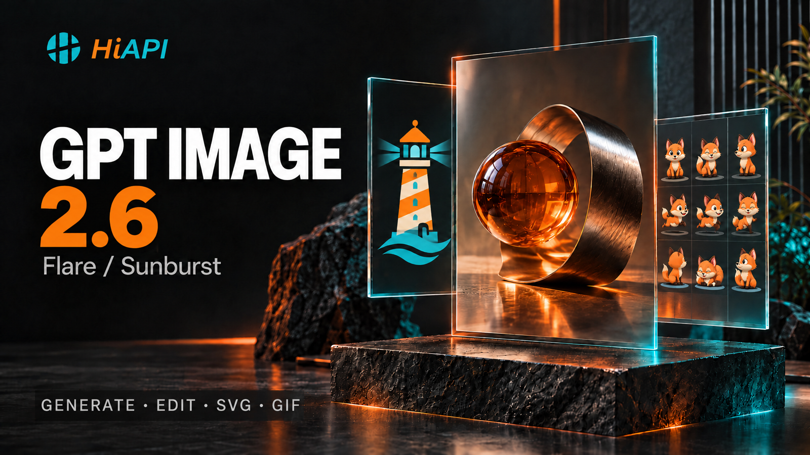

# GPT Image 2.6 Agent Skill — 一条命令出图、出矢量、出动画

在 Codex 或 Claude Code 里通过 HiAPI 生成产品图、把 Logo 导出成真正的 SVG、
做一小段 GIF，或者只改本地照片里的一块区域。CLI 根据输入自动选模型：没有参考
图用 `gpt-image-2.6-flare/text-to-image`，有参考图用
`gpt-image-2.6-flare/image-to-image`；`--family sunburst` 切到 Sunburst 一系。
2.6 每个模型都直接接受 `--quality`，不再需要记 pro 路由。

[中文](README.zh-CN.md) · [English](README.md) · [Flare 文生图](https://hiapi.ai/zh/models/gpt-image-2.6-flare-text-to-image?utm_source=github&utm_medium=readme&utm_campaign=hiapi-gpt-image-2-6) · [Flare 图生图](https://hiapi.ai/zh/models/gpt-image-2.6-flare-image-to-image?utm_source=github&utm_medium=readme&utm_campaign=hiapi-gpt-image-2-6) · [Sunburst 文生图](https://hiapi.ai/zh/models/gpt-image-2.6-sunburst-text-to-image?utm_source=github&utm_medium=readme&utm_campaign=hiapi-gpt-image-2-6) · [Sunburst 图生图](https://hiapi.ai/zh/models/gpt-image-2.6-sunburst-image-to-image?utm_source=github&utm_medium=readme&utm_campaign=hiapi-gpt-image-2-6) · [API Key](https://console.hiapi.ai/en/dashboard/api-keys?utm_source=github&utm_medium=readme&utm_campaign=hiapi-gpt-image-2-6) · [价格](https://hiapi.ai/en/pricing?utm_source=github&utm_medium=readme&utm_campaign=hiapi-gpt-image-2-6) · [文档](https://hiapi.ai/docs/?utm_source=github&utm_medium=readme&utm_campaign=hiapi-gpt-image-2-6)

## 亮点

| | |
| --- | --- |
| **一个开关出 SVG** | `--svg` 返回真正的矢量文件；CLI 按内容识别，不看扩展名。 |
| **GIF 不再吃 400** | `--gif` 加上 `--aspect-ratio 16:9` 会被换算成 `frame_size`（短边 512、两边取 16 的倍数），换算结果写在输出里。 |
| **本地文件直接用** | `--image ./photo.png`、`--mask ./mask.png` 自动上传到 `/v1/uploads`，按内容哈希缓存，上传前先在本地检查。 |
| **付费前先验 mask** | mask 必须是 RGBA PNG，且和第一张图同尺寸；这一步完全离线。 |
| **从 2.5 平滑迁移** | 2.5 的模型 ID 和 `--route pro` 照样能跑，自动映射到 2.6 等价模型并给一行说明。 |
| **花钱前先算账** | `--estimate` 显示命中的价格规则、参考图加价和当前活动；`--max-cost 0.10` 超了就不下单。 |
| **每个错误都给下一条命令** | 缺 key、402、429、字段非法、超时、下载链接过期——JSON 的 `next` 字段直接给可复制的命令。 |
| **带签名的自动更新** | Ed25519 签名的版本在下次运行时自动安装；公钥编译在代码里，仓库被攻破也只能验签失败。 |

Flare 和 Sunburst 在同一模式下 schema 完全相同。官方描述说 Flare 出图更快、
适合快速迭代；Sunburst 在 medium 及以上质量的多轮编辑中细节更一致。

## 一键安装

```bash
npx -y github:HiAPIAI/hiapi-gpt-image-2-6-skill -y
```

`-y` 会装进探测到的所有 agent 技能目录（`~/.codex/skills`、`~/.claude/skills`）。
用 `--target=/path/to/skills`、`--codex`、`--claude` 或 `AGENT_SKILLS_DIR` 指定单一
目录。安装器不依赖 git，只替换同名本技能，拒绝符号链接。

从本地检出安装：

```bash
node scripts/install.mjs --target=/path/to/skills
node scripts/hiapi-gpt-image-2-6.mjs --help
```

只在创建或恢复任务时才需要设置 `HIAPI_API_KEY`。

## 例子

### 1. 文生图

```bash
node scripts/hiapi-gpt-image-2-6.mjs \
  --prompt "清晨安静的高山湖泊，薄雾，35mm 胶片质感" \
  --aspect-ratio 16:9 --resolution 2K --quality medium
```

### 2. Logo 出 SVG

```bash
node scripts/hiapi-gpt-image-2-6.mjs \
  "极简灯塔标志，两色，粗线条，纯色背景" \
  --svg --quality high --dry-run --estimate
```

去掉 `--dry-run --estimate` 才会真正提交。CLI 确认内容确实是 SVG 文本后，按
`.svg` 保存。

### 3. 一小段循环 GIF

```bash
node scripts/hiapi-gpt-image-2-6.mjs \
  "红球在白色地面上弹跳，无缝循环" \
  --gif --aspect-ratio 16:9 --frame-count 12 --frame-duration-ms 120
```

payload 里是 `frame_size: 912x512`、没有 `aspect_ratio`；换算写在输出的
`adjustments` 里。

### 4. 只改本地照片的一块

```bash
node scripts/hiapi-gpt-image-2-6.mjs \
  "把天空改成深紫黄昏，建筑和水面保持不动" \
  --image ./harbour.png --mask ./harbour-sky-mask.png \
  --quality high --dry-run --estimate
```

`--mask` 是全透明的像素标记要改的区域，必须是 RGBA PNG 且与 `./harbour.png`
同尺寸。只想圈一个范围而不涂改时，用 `--markup ./circle.png`。

### 5. 从 GPT Image 2.5 迁移

```bash
# 以前
node scripts/hiapi-gpt-image-2-5.mjs --route pro --quality high "..."
# 现在：同一个意思，一个模型，同一个 quality 参数
node scripts/hiapi-gpt-image-2-6.mjs --quality high "..."
```

2.5 的 ID 仍可直接传入：`--model gpt-image-2.5-sunburst@pro` 会映射到
`gpt-image-2.6-sunburst/<模式>`，并在 stderr 给一行说明。完整对照见
[MIGRATION.md](MIGRATION.md)。

### 恢复任务，不重复付费

```bash
node scripts/hiapi-gpt-image-2-6.mjs --resume-task-id tk-hiapi-...
```

超时或下载链接过期都能这样恢复；任务被接受的那一刻，任务 ID 已经打印到 stderr。

## 估价与 `--max-cost`

`--estimate` 读公开的价格和活动接口，按「规则键最多的优先」命中价格（SVG、GIF
的规则会压过普通的 quality × resolution），每张参考图加 `$0.012`，再乘当前活动
倍率。输出里有 `listUsd`、`ruleName`、`referenceAddonUsd`、`promotion.slug` 和
`estimatedUsd`。

`--max-cost 0.10` 在估价超出时拒绝下单；估价失败时同样拒绝，因为无法验证的上限
不叫上限。不设 `--max-cost` 时，估价失败只做提示。

价格会变。今天 `1K`、`low` 起价 `$0.023` 一张，请当作快照，以 `--estimate` 和
[定价页](https://hiapi.ai/en/pricing?utm_source=github&utm_medium=readme&utm_campaign=hiapi-gpt-image-2-6) 为准。

## 自动更新

每次运行都会用 4 秒超时读一个小的策略文件；有更新的 1.x 版本时，会在**验证
Ed25519 签名（覆盖发布清单）和每个文件的 sha256** 之后安装。公钥写死在源码里，
不读环境变量，所以 GitHub 仓库、tag 或 raw CDN 被攻破也推不进代码，只会验签失败。

- 更新在**下一次**运行生效；当前这次跑完加载的代码，并打印一行提示。
- 备份放在 `~/.cache/hiapi-skills/hiapi-gpt-image-2-6/prev-<版本>/`，绝不放在
  技能目录里。
- 关闭：`HIAPI_SKILL_AUTO_UPDATE=off` 或 `--no-auto-update`；手动更新：`--update`；
  查看本地状态：`--version`。
- 大版本只提示、不自动装（`--update --allow-major` 才装）。
- 策略源挂了照常生成，输出里标 `unverified`。

完整设计见 [references/upgrade-policy.md](references/upgrade-policy.md)。

## 常见问题

**支持 GPT Image 2 或 2.5 吗？** 不支持。本技能只向四个 2.6 模型发请求；它接受
2.5 的 ID 作为输入并映射到 2.6，方便迁移，但请求本身永远落在 2.6 上。

**GIF 为什么看起来像一堆格子？** 那是服务端把帧拼成的一张总图。估算出的总图超过
3840 px、8,294,400 像素或 3:1 时 CLI 会警告；服务端遇到超限会拒单且不扣费。

**参考图可以用 data URI 吗？** 不行。传本地路径（自动上传）或公开 HTTPS URL。

**透明背景是真的吗？** `--background transparent` 需要 `png` 或 `webp`，API 会返回
带 alpha 通道的图。

**估价包含上新折扣吗？** 包含，只要 `/api/promotions` 里有覆盖该模型的进行中活动。
估价会打印活动 slug 和结束时间，并注明以实际扣费为准。

**产物存哪？** 默认 `outputs/`；用 `--output-dir` 改，或用 `--no-save` 只拿 URL。

## 目录结构

```
SKILL.md                 agent 指令与命令表
references/api.md        字段、限制、allOf 规则、计价逻辑
references/output.md     格式识别、恢复、质检
references/workflow.md   需求 → 预检 → 提交 → 质检 → 交付
references/local-files.md 上传与 mask 规则
references/upgrade-policy.md 带签名自动更新的每一步
scripts/hiapi-gpt-image-2-6.mjs   CLI 入口
scripts/install.mjs              安装器
scripts/release-sign.mjs         发布签名（维护者用）
scripts/check-config.mjs         线上契约检查
tests/                           离线测试与契约快照
```

## 许可

MIT。
